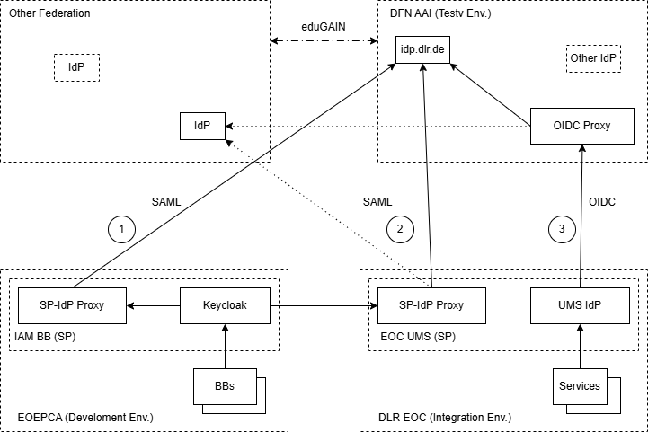

# Integration with eduGAIN

## Introduction

### What is eduGAIN?

EduGAIN is an interfederation service that establishes trust between
entities (SPs and IdPs) of its member federations. However, eduGAIN
is not a federation itself. Hence only federations can be a direct
member of eduGAIN.

Entities can only join eduGAIN via one of its member federations,
which are typically national federations for research and educational
entities. In most cases, there is exactly one such federation per
country. However, there are still many countries (mostly outside
Europe and North America), that do not have a national federation
that is an eduGAIN member. 

The role of eduGAIN is to make IdPs in any given member federation
interoperable with SPs from any other member federation. Thus,
at least in theory, a user authenticated at any IdP that is part of
eduGAIN may use any SP that is registered in eduGAIN. In practice,
however, SPs often limit the set of IdPs they accept, or they
require a certain level of assurance that not every IdP can
guarantee or attributes that not every IdP can deliver. Likewise,
IdPs typically only accept authentication requests from known SPs
or SPs that are run by trusted organizations. 

Note that not all entities of a member federation are automatically
part of eduGAIN. For each single entity, it is an individual decision
whether it should be exposed to eduGAIN or not.

### Challenges

#### IdP discovery

EduGAIN meanwhile comprises several thousand IdPs and SPs, which do
not necessarily know anything about one another. This gap is bridged
by a discovery service that allows users to discover and select the
IdP they want to use to log in. Usually this is the IdP of their
home organization.

The discovery process is triggered by the SP when it requires the
user to log in. Thus, the SP determines which discovery service to
use. This can be a custom discovery service or one provided by an
external entity like the eduGAIN member federation the SP is member
of. A custom discovery service allows the SP to limit the selectable
IdPs to those it actually accepts. In contrast, a federation-provided
discovery service usually offers all IdPs of its federation,
eduGAIN or both.

#### Keycloak limitations

Keycloak cannot support eduGAIN directly, because it requires each
federated IdP to be configured separately and explicitly. Thus, it
does not support dynamic IdP discovery.
Furthermore, Keycloak assigns an individual endpoint URL to each single
federated IdP, whereas eduGAIN relies on a single well-known assertion
consumer service endpoint that is used by all IdPs.

This can be solved by putting an SP-IdP proxy like
[SATOSA](https://daasi.de/en/satosa-a-modular-proxy/) in
front of Keycloak. The proxy appears to Keycloak as a single IdP
and integrates with eduGAIN as a SP. It also initiates IdP selection.
The proxy can be connected to Keycloak through OIDC or SAML.
EOEPCA+ uses OIDC as its standard authentication protocol, and
thus it is also preferred here for consistency.

Some national federations like DFN AAI also provide an OIDC proxy
that takes the role of the SP-IdP proxy. If such a proxy is available
it can be used instead of a custom SP-IdP proxy, at least if there
are no specific requirements on the discovery process and required
attributes.

#### Attribute Mapping

IdPs and SPs need a common understanding on the attributes they
provide or consume, respectively. Fortunately, eduGAIN addresses
this requirement by specifying a common set of attributes that
IdPs must or may provide and that SPs may expect. This set is
based on standard X.500/LDAP attributes and the `eduPerson` and
`SCHAC` schemas. However, most of these attributes are optional.
Additionally, the set of attributes has evolved over time, and so
not all IdPs necessarily support all attributes. The requested
attributes (for SPs) or supported attributes (for IdPs) are
documented in the respective metadata entries.

Most IdPs only release a minimal set of attributes (possibly none
except a transient user identifier) to SPs by default. If an SP
requires additional attributes, these need to be released
explicitly on IdP side. Thus, though eduGAIN establishes a general
pairwise trust relationship between all of its IdPs and and all
of its SPs, it does not ensure effortless pairwise
interoperability by itself.

The SP metadata, including the set of requested attributes, is
defined as part of the SATOSA backend configuration. From there
it can be taken over into the official metadata entry.

SATOSA also allows specifying mappings between external (SAML)
attributes and internal (OIDC) attributes. This allows customizing
the available attributes on OIDC side as needed. Custom scopes
can be defined to include non-standard attributes (beyond the
`openid` and `email` scopes) and make them available to Keycloak.
This is especially useful for `eduPerson` attributes like
`eduPersonAffiliation`.

#### Identification of Users

EduGAIN supports four different attributes that identify users in
a persistent way. These are documented
[here](https://wiki.geant.org/spaces/eduGAIN/pages/121348100/Identifier+Attributes).

In addition, a subject ID as specified by the
[SAML V2.0 Subject Identifier Attributes Profile](https://docs.oasis-open.org/security/saml-subject-id-attr/v1.0/cs01/saml-subject-id-attr-v1.0-cs01.html)
(typically a pairwise ID) may be present, and SAML also supports a
`&lt;saml:NameID&gt;` element that may contain a transient or persistent
user identifier. The `NameID` ist still relevant for backward compatibility
on the technical level. On the logical level, it has been replaced with
the subject ID.

The following options are most relevant for identifying users:

* `mail` attribute: An e-mail address specified in a user entry can
  be assumed to belong to the corresponding user. We already use e-mail
  addresses in EOEPCA to associate users accounts from different external
  IdPs. However, using the e-mail address as an official user
  identifier in conjunction with eduGAIN would be too risky.
  Users from different IdPs would effectively have the same
  user ID from the EOEPCA IAM's perspective if they have the same
  e-mail address. Without any additional countermeasures, this would
  allow an attacker who gains control over an eduGAIN IdP to create
  fake user accounts for users from other eduGAIN IdPs by simply
  copying their e-mail address.
* `eduPersonPrincipalName` attribute: This is a human-readable, scoped
  and thus globally unique user identifier. It is composed of an
  organization-specific user name and a suffix that denotes the
  organization. This attribute is supported by most IdPs. Its
  main disadvantage is that it exposes the user's actual user name,
  which may not always be acceptable. The global nature of this
  attribute allows identifying users across different SPs (and thus
  e.g. between EOEPCA platforms), which is useful for cross-platform
  scenarios.
* `eduPersonTargetedId` attribute: This is a technical user
  identifier that is targeted to a specific SP. This means that it
  does not allow identifying users across SPs. The attribute itself
  is being deprecated, and it is recommended that its value
  should be transmitted as a Subject Identifier instead. This
  ongoing transition process reduces the reliability of this
  attribute. Furthermore, its targeted nature impairs
  identification of users across SPs/platforms.

All in all, using `eduPersonPrincipalName` appears to be the
most appropriate solution for EOEPCA in general. Individual
platforms may still decide differently though if required for
some reason. Platforms that need to collaborate, however,
should agree on a common way to identity users.

### Integration Approaches

EduGAIN is based on the SAML standard. There are intentions to migrate
EduGAIN to OpenID Connect and OpenID Federation, but these are still
in an early state. The OIDC Proxy of DFN AAI is a first step into this
direction.

Thus, SAML is the only portable way to integrate with eduGAIN, because
only SAML is guaranteed to be supported by all participating federations.
Therefore this approach has been chosen for EOEPCA. The IAM BB of
the EOEPCA Reference Environment is integrated into the DFN AAI
Test federation as a SAML SP via an SP-IdP proxy. The test federation
is technically compatible with the official DFN AAI federation and
eduGAIN.

Some federations provide their own SP-IdP proxy to which external
entities can attach. E.g., DFN AAI provides an OIDC proxy that
allows SPs to integrate through OpenID Connect. This simplifies
integration a lot, but also comes with a few drawbacks:

* From the eduGAIN or DFN AAI point of view, the proxy appears as a
  single SP. Thus, IdPs cannot distinguish between different services
  that use the proxy, but either have to accept them all or none of
  them.
* From the service's point of view, the proxy appears as a single IdP.
  Furthermore, the proxy handles IdP discovery internally, supporting
  a predefined set of IdPs. Thus, the SP cannot restrict the set of IdPs
  that it accepts upfront, but only derive it from the token claims
  after authentication.
* The supported set of attributes of the proxy is fixed. Thus, services
  that use the proxy cannot request custom attributes from IdPs.

In the long run, eduGAIN plans to support OpenID Federation. Some
federations like DFN AAI participate in pilot projects that support
this objective. When full OpenID Federation support is reached,
compatible services will be able to integrate with eduGAIN directly
using OIDC if their SP software supports OpenID Federation.
Note that Keycloak does not support OpenID Federation yet, so basically
the same limitations as for SAML apply.

### Example Setup

The EOEPCA+ Development Environment is integrated with eduGAIN via DLR
and DFN AAI via two ways:

1. An SP-IdP proxy in the EOEPCA+ Development Environment: This proxy is
   only attached to the DFN AAI Test Federation. (done)
2. An SP-IdP proxy in the DLR EOC UMS Environment (optional): Initially,
  this proxy should also be attached to the DFN AAI Test Federation,
  but it might give us the chance to publish it to eduGAIN as well
  (at least temporarily for demonstration) if we are able to meet
  the legal and contractual prerequisites. It is still unclear, though,
  if this will be possible. (open)

In both cases, the proxy is based on SATOSA.

In parallel, DLR are integrating some of their services with the DFN
AAI OIDC Proxy with the intent to make them available productively
in eduGAIN. This integration approach is also documented as an option
for EOEPCA+ platforms. It is marked as option 3 in the figure above.
More information about the proxy can be found (in German)
[here](https://doku.tid.dfn.de/de:shibidp:oidc-proxy).

For all three options, `idp.dlr.de` is used as the primary IdP to test
against. This is a production IdP that is available in the DFN test
and production federations as well as in eduGAIN. Furthermore, several
members of the EOEPCA team have an account on this IdP. 

The integration of the EOEPCA Development Environment with the DFN AAI
Test Environment via an SP-IdP proxy in the EOEPCA Development
Environment is finished. The respective SATOSA setup can be found
[here](https://github.com/EOEPCA/eoepca-plus/tree/deploy-develop/argocd/eoepca/iam/parts/satosa). 

### Looking Ahead: OpenID Federation

At present, eduGAIN is entirely based on SAML. However, it is
envisaged to also support OIDC natively in eduGAIN and maybe even
replace SAML with OIDC on the long run.

OIDC alone is insufficient to handle the complexity of eduGAIN
as it is based on mutual trust. Therefore it is foreseen to
implement [OpenID Federation](https://openid.net/specs/openid-federation-1_0.html),
which allows establishing trust between an arbitrary set of
IdPs and SPs and can replace the SAML metadata distribution
infrastructure.

DFN AAI is involved in the
[eduGAIN OpenID Federation Pilot](https://connect.geant.org/2025/10/13/edugain-piloting-use-of-openid-federation)
project that aims at evaluating OpenID Federation for eduGAIN. This
is just an evaluation and demonstration project though (see
[GitHub repository](https://github.com/GEANT/edugain-oidf-pilot)
for details). So it may take a while until an OpenID Federation
infrastructure is actually available and supported by a significant
number of eduGAIN entities.

Furthermore, Keycloak does not yet support OpenID Federation.
Thus, even if it were already available, we would currently
not be able to leverage it directly.

## Preparation and Legal Aspects

### Check Prerequisites

Only educational and research organizations may join eduGAIN via one
of its member federations. Federations may handle this requirement
more or less strictly, though.

Furthermore, this is primarily relevant for the IdP side, because
the main purpose of eduGAIN is to provide an interfederation service
for the education and research community. However, a non-research
organization may still provide a service that is of major interest
for the community. In this case, this organization may be eligible
to become a federation member (only for the SP side) and contribute
its service. If in doubt, this should be negotiated with possible
candidate federations.

### Select National Federation

Integration with eduGAIN requires membership in a national federation
that participates in eduGAIN. Organisations that belong to a certain
country would typically choose the national federation of their home
country.

However, for international organisations like ESA, it may
be more difficult to choose an appropriate federation. Such
organisations should first contact the national federation of the
country in which their headquarters are located. If this federation
rejects membership, national federations of other countries with
some relationship to the organisation should be tried.

As an alternative, a collaboration with some national organisation
can allow access to a national federation. In the case of the
EOEPCA+ project, we collaborate with DLR, which is a member of
DFN AAI.

### Join Federation

The process to join a national federation may differ between federations.
Generally you need to sign some kind of agreement with the
federation provider and assure that you will adhere to their regulations. 

These regulations typically cover aspects like data protection and, for
an IdP, reliability of the information provided by that IdP. They also
include a code of conduct.

The regulations imposed by the eduGAIN member federations comprise at
least the general regulations required by eduGAIN (see
[these documents](https://technical.edugain.org/documents)),
but may include further obligations.

E.g., the minimum requirements for data protection differ from
country to country. National federations must follow these requirements
and thus may have to require a higher level of protection than eduGAIN
itself does. E.g., federations located in the EU like DFN AAI need to
ensure that the
[EU General Data Protection Regulation (GDPR)](https://gdpr.eu/) is met.

### Adopt Further Policies

Some IdPs impose additional restrictions on the SPs they serve
(or vice versa). This section briefly describes some common ones.

#### Entity Categories

By default, most IdPs do not release any metadata except a subject
identifier. If more attributes are required, they must be released
explicitly on IdP side.

[Entity categories](https://wiki.refeds.org/spaces/ENT/pages/1605669/Entity-Categories+Home)
are an alternative and more scalable way to control attribute
release.
An entity category constitutes a set of entities that conform
to common characteristics. E.g., this may be a set of SPs that
require a common set of attributes and are known to meet a data
protection policy that allows them to consume these attributes.
An IdP could then decide to release these attributes to all
SPs in this category without knowing the individual SPs.

Note that this mechanism should only be used for "low-risk"
attributes. Confidential information should only be released
individually to known SPs on a need-to-know basis.

There are predefined entity categories like
[Coco v.2](#refeds-data-protection-code-of-conduct-coco-v2),
but custom categories can also be defined and registered if needed.

#### Sirtfi

Sirtfi stands for "Security Incident Response Trust Framework
for Federated Identity". Sirtfi-compliant entities guarantee proper
handling of security measures and events in a specified way.
This includes provision of a security contact, use of
up-to-date software, adherence to SSL best practices and timely
reporting of security incidents. See the
[Sirtfi Home page](https://wiki.refeds.org/spaces/SIRTFI/pages/10125343/SIRTFI+Home)
for more details.

Some IdPs only accept Sirtfi-compliant SPs. SPs that need to
use those IdPs are thus forced to adopt Sirtfi.

#### REFEDS Data Protection Code of Conduct (CoCo v.2)

This is an [entity category](#entity-categories) that signals
adherence of an entity to the EU GDPR best practices.
This also implies conformance to Sirtfi. More details can be
found [here](https://refeds.org/category/code-of-conduct/v2).

Some IdPs (mostly in the EU) require this entity category for
their SPs. 

## Setup

### Preparation

#### Required Information

The registration process requires some administrative information,
which should be collected in advance. This information is
specified in the configuration of the proxy backend, which uses
it to generate a SAML metadata XML file. This file should then be
used as the source of information for the actual entity registration.
This way it is ensured that the metadata is consistent between
the proxy itself and its representation in eduGAIN.

The following information is usually required:

* Entity ID: Typically the URI of the proxy or the base URI of
  the EOEPCA platform
* Contact information (name and e-mail for administrative,
  technical and security issues and for general support)
* Certificate (at least 3072 bits, issued by an official CA)
* Discovery response URL (can be derived from proxy base URL)
* Location and binding of assertion consumer service (can be
  derived from proxy base URL)
* Name and base URL of your organization
* Name and description of your service (platform)
* URL and type of metadata source (depends on federation)

#### DNS Domain

SATOSA does not support path-based routing and thus needs
its own DNS hostname. So there must be an appropriate DNS
entry for the desired hostname and an `ApisixTls` resource
that covers it.

Note that in principle it is also an option to publish
SATOSA at the root of the platform hostname. This might be
necessary if it is not possible to allocate a separate
hostname for some reason. In this case, the individual
subpaths of SATOSA need to be routed individually, and care
must be taken that they do not conflict with anything else.
The EOEPCA example configuration of SATOSA exposes at least
the following paths:

* `/.well-known/*`
* `/OIDC/*`
* `/Saml2/*`

### Set up SP-IdP Proxy

The SATOSA proxy is deployed as a stateful set with some
miscellaneous resources like a route, a service, a configmap
and two secrets.

The configuration of the SATOSA proxy is based on the [configuration
examples](https://github.com/IdentityPython/SATOSA/tree/master/example)
provided by SATOSA. It is deployed as a configmap, except for the
OIDC client configuration, which contains sensitive information and is
therefore stored in a secret. Note that deviating from the
original example, all configuration files are mounted directly
to the container directory `/etc/satosa` (without a subdirectory
structure).

The example SATOSA setup on the EOEPCA+ Development Environment
can be found
[here](https://github.com/EOEPCA/eoepca-plus/tree/deploy-develop/argocd/eoepca/iam/parts/satosa).
You should copy this example setup and adapt it according to your
needs. Note that the IAM BB Helm chart does currently not support
setting up SATOSA, and there is no official SATOSA Helm chart either.
This may change in the future.

The example setup consists of the following files:

* `apisixroute-satosa.yaml`: Defines a route for SATOSA.
  The `hosts` entry should be adapted as needed. Note that SATOSA
  does not support path-based routing and thus must be published
  at the server root.
* `service-satosa.yaml`: Defines a service for SATOSA. Usually
  does not need customization.
* `statefulset-satosa.yaml`: The stateful set that manages the
  SATOSA pod. Usually does not need customization, except through
  the following configuration items that are mounted into the
  SATOSA container:
* `cm-satosa-config.yaml`: Defines the configmap `satosa-config`
  that contains most required SATOSA configuration files.
  Should be customized as needed (see below).
* `ss-satosa-cdb.yaml`: Sealed secret that defines the SATOSA
  OIDC client to be used by Keycloak. Use the script
  `ss-satosa-cdb.sh` to create the sealed secret definition or
  create the (non-sealed) secret `satosa-cdb` directly if
  preferred. Note that the secret is also referenced from the
  eduGAIN federation configuration section in `iam-values.yaml`
  to obtain the proper client ID and secret.
* `cert-satosa.yaml`: Defines the certificate used to sign and
  optionally encrypt SAML messages. The generated certificate
  is stored in a secret named `satosa-cert`. Note that the
  public part of this certificate is published as part of the
  service provider registration entry. Thus the registration
  entry must be updated when the certificate is regenerated.
  See [this section](#saml-certificate-rotation) for more
  information.

The configmap `satosa-config` contains the following
configuration files:

* `internal_attributes.yaml`: Defines the relevant attributes
  and their mappings to SAML and OpenID Connect. If further
  attributes are needed, they can be added here. The attribute
  `eduPersonAffiliation` may serve as a simple example.
* `oidc_frontend.yaml`: Configures the OIDC frontend.
  If attributes are added above, a scope should be defined
  here to make them available to Keycloak. The scope
  `edu_person` can be taken as an example. Further
  configuration entries may also be customized if needed.
* `proxy_conf.yaml`: Main SATOSA configuration file. The base
  URL must be customized as needed. Other settings (e.g. the
  `LOGGING` section) may have to be customized as well.
* `saml2_backend.yaml`: Configures the SAML backend.
  Most of the overall customization takes place here.
  Many of the settings are taken over into the generated SAML
  metadata entry and must be kept in line with the official
  service provider registration entry.
* `static_attributes.yaml`: Static attributes may be configured
  here if the `static_attributes` microservice is activated
  in `proxy_conf.yaml`. Not used otherwise.

More detailed information about the SATOSA configuration files
can be found in the
[SATOSA documentation](https://github.com/IdentityPython/SATOSA/blob/master/doc/README.md).

### Register Proxy with National Federation

The proxy needs to be registered with the national federation as an SP.
Like most federations, DFN AAI provides a registration form for this
purpose.

Most of the information to provide here is contained in the metadata
file that is generated by the proxy. If there is an option to import
this file, it should be used. Otherwise the relevant information
should be extracted from the metadata file and filled into the
registration form manually.

### Alternative: Use Federation-Provided SP-IdP Proxy

If the selected national federation provides a preconfigured
SP-IdP proxy, it can be used instead of setting up and
registering a custom proxy.

For the DFN AAI OIDC Proxy, client credentials can be
requested from the DFN AAI help desk by e-mail. There is
no automated registration process. The following information
must be provided:

* Service name and description
* Name and contact e-mail of service provider organization
* URI of data protection information
* Required claims (at least `sub`, `family_name`, `given_name`
  and `email` should be requested; `organization_name`,
  `eduperson_affiliation` and `eduperson_assurance` may be
  useful as well)
* Redirect URI

The official DFN AAI OIDC Proxy is integrated with eduGAIN
and thus allows using IdPs from both DFN AAI and eduGAIN.

A test proxy is also available. It is *not* integrated with
eduGAIN and only allows using IdPs from the DFN AAI Test
Federation. These also include most of the production IdPs
registered with DFN AAI, which allows for realistic testing.

### Configure Proxy as Federated IdP in Keycloak

#### Basic configuration

The SP-IdP proxy can be configured in Keycloak like any
other OIDC-based federated IdP. Refer to
[this guide](https://eoepca.readthedocs.io/projects/iam/en/latest/admin/configuration/idp/setup-other-idp/)
for details.

The declarative example setup is contained in the
[`iam-values.yaml` file](https://github.com/EOEPCA/eoepca-plus/blob/deploy-develop/argocd/eoepca/iam/parts/values/iam-values.yaml#L200)
of the EOEPCA+ Development Environment.

#### Support additional claims

If non-standard claims are required, additional scopes
configured in the SATOSA OIDC frontend may have to be
requested. This can be configured in the (initially
collapsed) "Advanced" subsection of the OpenID Connect
section of the federated IdP configuration form
(Identity providers > Provider details, tab "Settings").

Usually additional claims should also be stored in
the user entry. To accomplish this, attributes for
the additional claims have to be included in the
default user profile (in form Realm settings >
User profile) unless they can reasonably be mapped
to existing attributes.

Furthermore, a mapper needs to be configured for each
OIDC claim to be stored. (in the "Mappers" tab of form
Identity providers > Provider details)

Note that the default user profile is collapsed into
a single lengthy string in a realm export. Thus, if
additional attributes should be added to the default
user profile automatically during the initial realm
import, the complete default profile definition
including the standard attributes must be included
in the `iam-values.yaml` file or a custom
`KeycloakRealmImport` resource.

## Maintenance

### SAML Certificate Rotation

The example SATOSA setup uses CertManager to generate a
certificate using a `Certificate` resource. This certificate
is renewed every 90 days.

However, this solution is not suitable for production use,
because the renewed certificate gets into effect immediately
(tbc), but is not automatically published to eduGAIN.
This breaks eduGAIN connectivity at least temporarily every
time the certificate is renewed.

For a production setup, it is recommended to separate
certificate generation from certificate installation, e.g.
by generating the certificate into an intermediate secret
instead of the one that is mounted into the container.
The certificate can then be copied over manually or by a
script when it has been published. The sequence may be as
follows:

1. Generate a new certificate. This may be a manual process
   or automated through CertManager.
2. Add the new certificate to the SP registration entry.
   (in addition to the old one)
3. Wait until the modified entry has been published.
   (typically the next day)
4. Update the secret that is mounted into the SATOSA
   container. Maybe restart the container.
   SATOSA now uses the new certificate.
5. Remove the old certificate from the SP registration entry.

This assumes that there is a sufficient overlap between the
validity periods of the old and the new certificate.

If the federation provides an API for updating metadata
entries, the process can be automated. Otherwise it must be
performed manually.
